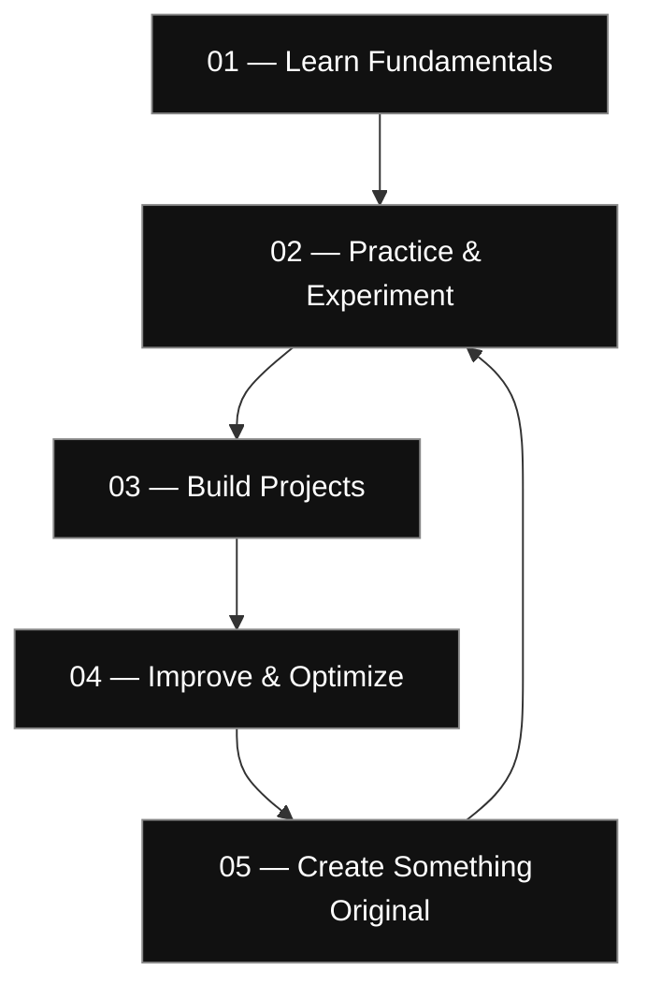

<!-- ===================================================== -->
<!-- MUSARAF HUSSAIN | MANGA EDITORIAL DEVELOPER PORTFOLIO -->
<!-- ===================================================== -->

 

  

 

━━━━━━━━━━━━━━━━━━━━━━━━━━━━━━━━━━━━━━━━━━━━

**DESIGNATION:** DEVELOPER IN PROGRESS  
**SPECIALIZATION:** SOFTWARE • AI • TECHNOLOGY  
**PHILOSOPHY:** LEARN. EXPERIMENT. CREATE.

━━━━━━━━━━━━━━━━━━━━━━━━━━━━━━━━━━━━━━━━━━━━

<!-- ===================================================== -->
<!-- 01 | INTRODUCTION -->
<!-- ===================================================== -->

# 01 — THE INTRODUCTION

PROFILE / 001

### Hello, I'm Musaraf Hussain.

I'm a **BCA student at BJS Rampuria Jain College**, interested in software development, artificial intelligence, cybersecurity and emerging technologies.

I enjoy exploring how technology works, experimenting with different tools, and turning what I learn into practical projects.

I believe that becoming a developer isn't about knowing everything. It's about staying curious, solving problems and continuously improving.

**A little about me:**

- 🎓 Computer Applications student
- 💻 Learning programming and software development
- 🧠 Exploring artificial intelligence and automation
- 🔐 Interested in cybersecurity and Linux
- 🎮 Exploring game development
- ⚙️ Focused on practical learning and experimentation

 

---

<!-- ===================================================== -->
<!-- 02 | TECHNOLOGY -->
<!-- ===================================================== -->

# 02 — THE TECHNOLOGY

TOOLS / 002

### Languages & Development

### Tools & Environments

### My Current Learning Focus

| Domain | Focus |
|:---|:---|
| Programming | C++ fundamentals and problem-solving |
| Development | Understanding how applications are built |
| Linux | Terminal commands and system fundamentals |
| Cybersecurity | Networking and ethical security concepts |
| Artificial Intelligence | AI assistants and automation |
| Game Development | Interactive systems and game mechanics |

Technologies shown represent my learning interests and tools I explore, not claims of professional expertise.

---

<!-- ===================================================== -->
<!-- 03 | AREAS OF INTEREST -->
<!-- ===================================================== -->

# 03 — THE INTERESTS

EXPLORATION / 003

<table>
<tr>
<td width="50%" valign="top">

### 01. SOFTWARE DEVELOPMENT

Understanding programming fundamentals, application logic, problem-solving and software design.

</td>
<td width="50%" valign="top">

### 02. ARTIFICIAL INTELLIGENCE

Exploring intelligent applications, AI assistants, automation and machine learning concepts.

</td>
</tr>
<tr>
<td width="50%" valign="top">

### 03. CYBERSECURITY

Learning Linux environments, networking fundamentals and ethical security practices.

</td>
<td width="50%" valign="top">

### 04. GAME DEVELOPMENT

Experimenting with gameplay mechanics, interactive environments and game systems.

</td>
</tr>
</table>

---

<!-- ===================================================== -->
<!-- 04 | CURRENT CHAPTER -->
<!-- ===================================================== -->

# 04 — THE CURRENT CHAPTER

LEARNING LOG / 004

| Learning Path | Objective |
|:---|:---|
| C++ | Improve programming logic and understand OOP |
| Python | Explore scripting and automation |
| Git & GitHub | Learn version control and project management |
| Linux | Become comfortable with command-line environments |
| Cybersecurity | Understand networking and security fundamentals |
| AI | Explore intelligent systems and practical applications |

<b>▸ My development philosophy</b>

- Understand the fundamentals before moving forward.
- Write code instead of only watching tutorials.
- Experiment with different approaches.
- Learn from errors and debugging.
- Build projects to apply knowledge.
- Improve consistently.

---

<!-- ===================================================== -->
<!-- 05 | DEVELOPMENT ROADMAP -->
<!-- ===================================================== -->

# 05 — THE ROADMAP

FUTURE / 005

| PHASE | OBJECTIVE |
|:---:|:---|
| 01 | Master programming fundamentals |
| 02 | Develop problem-solving skills |
| 03 | Build practical applications |
| 04 | Explore advanced technologies |
| 05 | Create original software projects |

 

**THE GOAL IS NOT TO RUSH. THE GOAL IS TO UNDERSTAND.**

---

<!-- ===================================================== -->
<!-- 06 | GITHUB -->
<!-- ===================================================== -->

# 06 — THE GITHUB SPACE

DEVELOPMENT / 006

  

This is where my learning journey, experiments and future projects will live.

**No shortcuts. No fake achievements. Just continuous progress.**

---

<!-- ===================================================== -->
<!-- 07 | FINAL PANEL -->
<!-- ===================================================== -->

# 07 — THE FINAL PANEL

 

### LEARN SOMETHING. BUILD SOMETHING. REPEAT.

Every expert was once a beginner.

  

 

© MUSARAF HUSSAIN • BUILT WITH CURIOSITY.

---

<!-- ===================== ABOUT ===================== -->

## 01 / ABOUT ME

I'm **Musaraf Hussain**, a Computer Applications student interested in software development, emerging technologies, and building useful digital experiences.

I enjoy understanding how things work, experimenting with new technologies, and improving my programming skills through practical projects.

- 🎓 BCA Student — BJS Rampuria Jain College
- 💻 Learning programming and software development
- 🧠 Exploring AI, automation and intelligent systems
- 🔐 Interested in cybersecurity and Linux
- 🎮 Exploring game development and interactive experiences
- ⚙️ Focused on learning by building real projects

 

> "Consistency creates what motivation only imagines."

---

## 02 / TECHNOLOGY STACK

### Languages

### Tools & Platforms

### Currently Exploring

---

## 03 / AREAS OF INTEREST

<table>
<tr>
<td width="50%">

### ◈ Software Development

- Programming fundamentals
- Problem solving
- Application development
- Learning software architecture

</td>
<td width="50%">

### ◈ Artificial Intelligence

- AI-powered applications
- Intelligent assistants
- Automation
- Exploring machine learning

</td>
</tr>
<tr>
<td width="50%">

### ◈ Cybersecurity

- Linux environments
- Networking fundamentals
- Ethical security concepts
- Practical security labs

</td>
<td width="50%">

### ◈ Game Development

- Game mechanics
- Interactive environments
- Roblox Studio
- Gameplay systems

</td>
</tr>
</table>

---

## 04 / CURRENTLY LEARNING

| Technology | Learning Focus |
|:---|:---|
| C++ | Programming logic, functions, OOP |
| Python | Scripting and automation |
| Linux | Terminal, commands and system basics |
| Git & GitHub | Version control and collaboration |
| Cybersecurity | Networking and security fundamentals |
| AI | Understanding and building AI-powered tools |

---

---

## 05 / PROJECT DEVELOPMENT HUB

### CURRENT FOCUS

<table>
<tr>
<td width="50%">

**01 — C++ Development**

Learning programming fundamentals, functions, loops and object-oriented programming.

</td>
<td width="50%">

**02 — Linux & Cybersecurity**

Exploring Linux environments, terminal commands and networking fundamentals.

</td>
</tr>
<tr>
<td width="50%">

**03 — Artificial Intelligence**

Exploring AI assistants, automation and intelligent applications.

</td>
<td width="50%">

**04 — Game Development**

Learning game mechanics, interactive systems and Roblox Studio.

</td>
</tr>
</table>

### PROJECT ROADMAP

| Project Idea | Planned Technologies | Status |
|:---|:---|:---|
| Personal Calculator | C++ | Learning |
| AI Personal Assistant | Python, AI | Planned |
| Weather Application | C++, API | Planned |
| Interactive Game | Roblox Studio, Lua | Planned |

### DEVELOPMENT PHILOSOPHY

> Don't just collect technologies. Learn them, experiment with them, and turn your knowledge into something real.

**THE JOURNEY HAS JUST STARTED.**

More projects coming as I learn and build.

---

## 06 / DEVELOPER MISSION CONTROL

### CURRENT OBJECTIVE

**Learn. Build. Experiment. Improve.**

A continuous journey from fundamentals to real-world development.

| Focus Area | Current Mission |
|:---|:---|
| `01` Programming | Strengthen C++ and problem-solving fundamentals |
| `02` Development | Build practical applications and projects |
| `03` Cybersecurity | Explore Linux, networking and security labs |
| `04` Artificial Intelligence | Experiment with AI-powered applications |
| `05` Game Development | Learn interactive systems and game mechanics |

### DEVELOPMENT ROADMAP

### CURRENT PRINCIPLES

- Build before perfection.
- Understand the code, don't just copy it.
- Learn through experimentation.
- Turn mistakes into improvements.
- Keep creating and documenting projects.

STATUS: ALWAYS LEARNING • ALWAYS BUILDING

