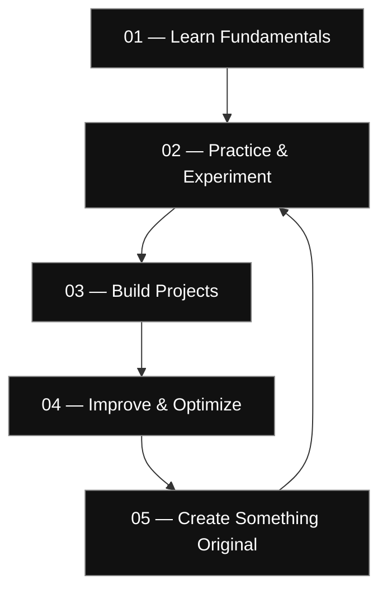

<!-- ===================== HEADER ===================== -->

 

---

<!-- ===================== ABOUT ===================== -->

## 01 / ABOUT ME

I'm **Musaraf Hussain**, a Computer Applications student interested in software development, emerging technologies, and building useful digital experiences.

I enjoy understanding how things work, experimenting with new technologies, and improving my programming skills through practical projects.

- 🎓 BCA Student — BJS Rampuria Jain College
- 💻 Learning programming and software development
- 🧠 Exploring AI, automation and intelligent systems
- 🔐 Interested in cybersecurity and Linux
- 🎮 Exploring game development and interactive experiences
- ⚙️ Focused on learning by building real projects

 

> "Consistency creates what motivation only imagines."

---

## 02 / TECHNOLOGY STACK

### Languages

### Tools & Platforms

### Currently Exploring

---

## 03 / AREAS OF INTEREST

<table>
<tr>
<td width="50%">

### ◈ Software Development

- Programming fundamentals
- Problem solving
- Application development
- Learning software architecture

</td>
<td width="50%">

### ◈ Artificial Intelligence

- AI-powered applications
- Intelligent assistants
- Automation
- Exploring machine learning

</td>
</tr>
<tr>
<td width="50%">

### ◈ Cybersecurity

- Linux environments
- Networking fundamentals
- Ethical security concepts
- Practical security labs

</td>
<td width="50%">

### ◈ Game Development

- Game mechanics
- Interactive environments
- Roblox Studio
- Gameplay systems

</td>
</tr>
</table>

---

## 04 / CURRENTLY LEARNING

| Technology | Learning Focus |
|:---|:---|
| C++ | Programming logic, functions, OOP |
| Python | Scripting and automation |
| Linux | Terminal, commands and system basics |
| Git & GitHub | Version control and collaboration |
| Cybersecurity | Networking and security fundamentals |
| AI | Understanding and building AI-powered tools |

---

## 05 / PROJECTS

| Project | Description | Status |
|:---|:---|:---|
| C++ Practice Collection | Beginner programming exercises and concepts | Learning |
| Personal GitHub Profile | A professional developer portfolio | Improving |
| AI Assistant Concept | Exploring an intelligent personal assistant | Exploring |
| Game Development | Experimenting with interactive game systems | Exploring |

---

---

## 06 / DEVELOPER MISSION CONTROL

### CURRENT OBJECTIVE

**Learn. Build. Experiment. Improve.**

A continuous journey from fundamentals to real-world development.

| Focus Area | Current Mission |
|:---|:---|
| `01` Programming | Strengthen C++ and problem-solving fundamentals |
| `02` Development | Build practical applications and projects |
| `03` Cybersecurity | Explore Linux, networking and security labs |
| `04` Artificial Intelligence | Experiment with AI-powered applications |
| `05` Game Development | Learn interactive systems and game mechanics |

### DEVELOPMENT ROADMAP

### CURRENT PRINCIPLES

- Build before perfection.
- Understand the code, don't just copy it.
- Learn through experimentation.
- Turn mistakes into improvements.
- Keep creating and documenting projects.

STATUS: ALWAYS LEARNING • ALWAYS BUILDING

